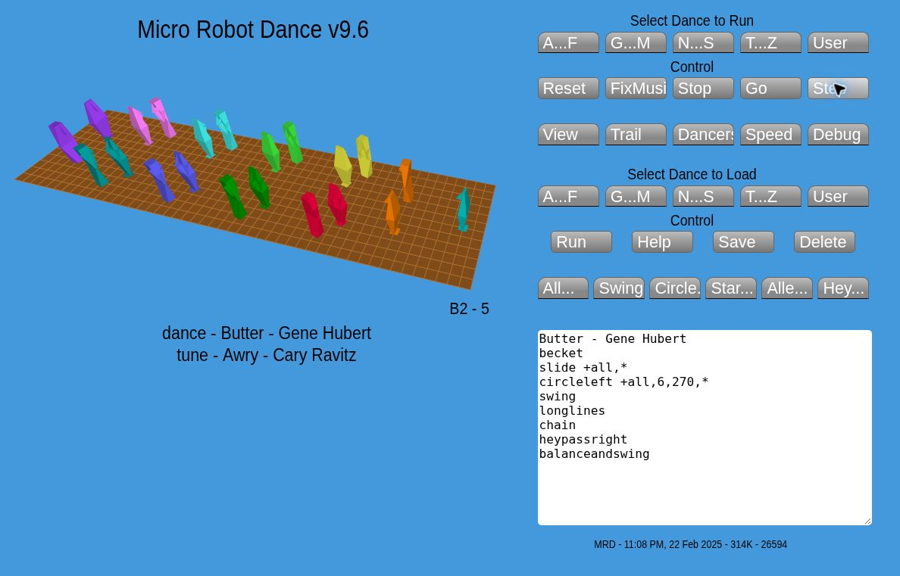
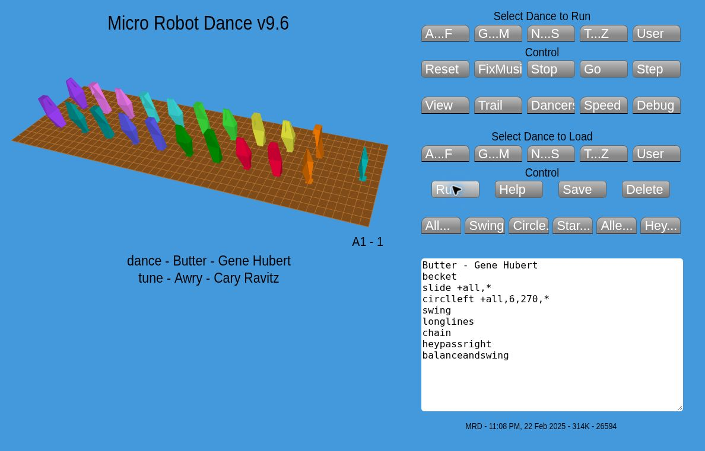
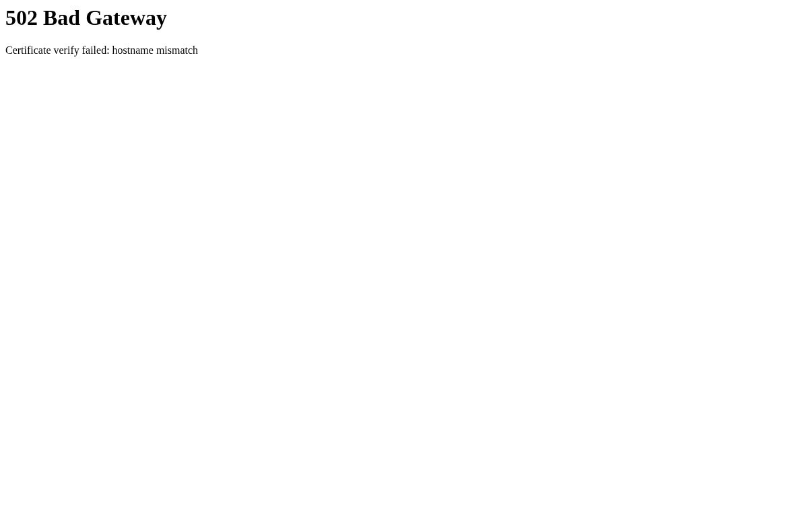
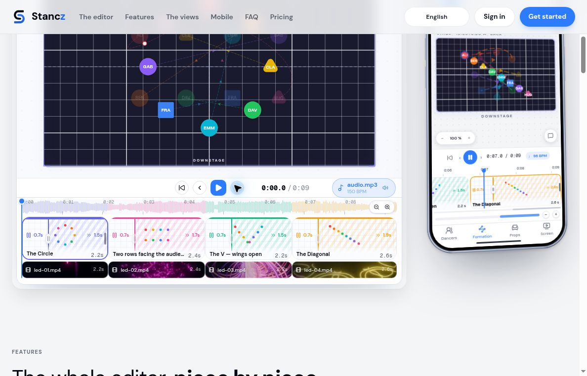
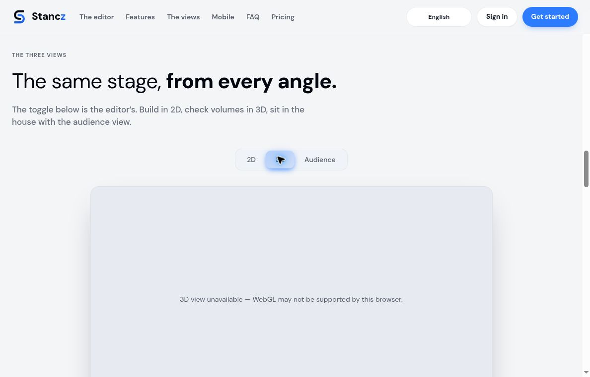

# Contra dance simulator: landscape, evidence, and product requirements

Research checked 18 October 2026. This combines public-web desk research with limited hands-on checks in our cloud Chrome browser. Product capabilities below are documented claims unless marked as observed. User comments are individual experiences, often historical; they establish concrete needs, not their prevalence among all callers.

## Recommendation

Build around **trustworthy full-dance rehearsal**: import a dance, inspect the interpretation, follow identifiable people through several repetitions and both ends of the line, and understand the resulting connections and transitions. Human-bodied 3D can make posture and connection clearer, but it must be driven by the same correct choreography as the overhead view.

The strongest opportunity is the combination of dance semantics, full-set progression, reviewable imports, and embodied movement. Animation itself already exists. Modern caller-library software and polished general formation editors also exist. This review did not verify a product that combines all of those capabilities with anatomically credible contra-specific partner connections.

## Competitor and adjacent-tool matrix

| Tool | Verified/documented strengths | Gap relative to this project | Evidence/date |
|---|---|---|---|
| **Micro Robot Dance**, Cary Ravitz | Working full-dance builder observed as v9.6: 2D/3D, path trails, speed options, 18/20 dancers and an Arms option. | A mistyped command caused a console exception without an inline error, leaving an old scene visible. Its robot rendering is geometrical rather than anatomical. | [Product](https://www.dance.ravitz.us/mrd.php), hands-on 18 Oct 2026; [caller report](https://www.mail-archive.com/contracallers@lists.sharedweight.net/msg00144.html), 10 Feb 2020 |
| **Up a Double / George Williams** | Extensive country-dance animations, including contra; stable couple colours, current-role borders, visible facing, slowed introductory repetition, and alternative versions for some end effects. | Published videos/abstract markers rather than a verified consumer 3D authoring workflow. Creator acknowledges imperfect automatic figure classification. | [About and help](https://www.upadouble.info/about.php), undated live page; [contra example](https://www.upadouble.info/dance.php?id=KindredSpirits) |
| **Dance Kaleidoscope**, Keith Wood | Downloadable dance animator documented by Colin Hume; Keith publicly offered to add dances during 2020. | Cloud browser returned 502 and a certificate hostname-mismatch message. Present interaction and maintenance status remain unverified; this is not evidence of discontinuation. | [Referenced product](https://dancekaleidoscope.au/dance.html), hands-on attempt 18 Oct 2026; [Hume](https://colinhume.com/cardboard.htm), [Keith’s 2020 announcement](https://blog.bushmusic.org.au/2020/03/online-stuff-to-do-watch-in-these-days.html) |
| **Dance Organiser / Virtual Whiteboard**, Colin Hume | Repertoire and event planning, calling history, music, large-text calling, CSV import; animation whiteboard with reusable figure library. | Windows-oriented workflow. The author says preparing his animated presentation took substantial effort. Rich planning is already available; the opportunity is easier simulation authoring. | [Official documentation](https://colinhume.com/download.htm), live page lists v6.103; whiteboard introduced for Nov 2020 presentation |
| **Taminations**, Brad Christie | Mature square-dance call animations and sequencer; official app lists over 2,500 animations and 500 calls. Definitions, directional markers, paths, and handhold indicators are useful precedents. | Square-dance semantics are not a contra progression engine. Documentation explicitly simplifies handhold styling and acknowledges timing differences. | [Official guide](https://www.tamtwirlers.org/tamflash/info/howtouse.html), legacy/undated; [Google Play](https://play.google.com/store/apps/details?hl=en_US&id=com.bradchristie.taminationsapp), updated 7 Sep 2026 |
| **ContraDB** | Figure-combination search, exclusions, user dialects, dance entry, and programs. Source released under AGPL3. | Its about page describes program visualization/analysis as future work; a full embodied simulator was not demonstrated by these materials. | [Official about](https://contradb.com/about), undated live page |
| **Caller’s Compendium**, Isaac Banner | Current local-first beta: structured/free-text choreography, programs, stage mode, dialect layer, and Caller’s Box/ContraDB URL-or-ID imports through a review queue. Offline use and portable backups are documented. | Strong adjacent library/programming product; reviewed feature documentation does not demonstrate a full-body contra simulator. Interoperation is more promising than duplicating every library feature. | [Official repository](https://github.com/ibanner56/CallersCompendium), current README checked 18 Oct 2026 |
| **Stancz** | Browser/mobile formation editor with curved travel, beat/music alignment, 2D, 3D and audience views, dancer-follow mode, shared workspaces and comments. | Designed around formation placement and travel. Contra figures, partner grips and full-line progression were not verified. Official FAQ says no PDF/image export today. | [Official product/FAQ](https://stancz.com/en), checked 18 Oct 2026 |
| **Croovoo** | 2D/3D formation views, explicit facing, curved paths, waveform timeline, dancer-specific share view, collaboration and staging analytics. | Stage-blocking focus. A dance-specific semantic engine or articulated partner contact was not verified. Homepage testimonials are vendor-selected, not independent evaluation. | [Official product](https://croovoo.com/), checked 18 Oct 2026 |
| **GridStage** | Open-source 2D/3D formation planning, music synchronization, real-time CRDT collaboration, video-assisted formation capture, PDF/video/GIF outputs; offline desktop distribution. | Useful workflow/architecture comparator, not evidence of contra-specific choreography or human partner mechanics. | [Official repository](https://github.com/ChangShengHsun/GridStage), checked 18 Oct 2026 |
| **DanceForms / Life Forms** | Poseable bodies, movement libraries, group animation, score/timeline concepts, and freely adjustable 3D viewing. | Body choreography is its documented strength; current availability/maintenance and contra semantics were not established. Manually authoring each body movement would undermine rapid dance-card import. | [Vendor page](https://www.lifeforms.com/danceforms/main.html), legacy 1.0 page, undated |
| **Contra Dance: A Visual Exploration**, Photomancer Lab | Recent experiment with whole-dance traces, temporal plots and figure strips to communicate a program’s feel. | Author explicitly identifies approximate paths, missing waves, no set ends, and closure as the only check. Valuable visual exploration, not a validated simulator. | [Project post](https://lab.photomancer.art/post/2026-09-13-contra-dance-visual-exploration/), 13 Sep 2026; indexed content available, direct fetch failed |

Historical comparator: **Contra Dance Designer** was described in a 2 Jan 2004 [rec.folk-dancing post](https://groups.google.com/g/rec.folk-dancing/c/f5Ph8n7l6rI/m/jLTYvq5OE2MJ) as Internet Explorer-specific and difficult to learn initially. Hume now says it no longer exists. Treat that as a portability lesson, not a claim about present competitors.

## Concrete praise and complaints

These observations are attributed, not invented usability judgments.

1. **Full-dance interaction and ends matter more than isolated moves.** On 9 Feb 2020, caller Becky Liddle described manually moving magnets as slow and error-prone; she could not reliably follow separated partners. She also said ordinary videos seldom showed end effects clearly. This is direct support for stable dancer identities, a full line, and end-focused playback. [Original request quoted in the thread](https://www.mail-archive.com/contracallers@lists.sharedweight.net/msg00137.html)

2. **Small visual controls materially improve teaching.** On 10 Feb 2020, Liddle praised Micro Robot Dance’s facing indicators, highlighted partners, and speed control. She used it to discover three re-entry moments that needed longer caller prompting. Her input complaint was that “the text has to be exactly right.” Implication: retain those controls and replace fragile command entry with guided, reviewable input. [First-person report](https://www.mail-archive.com/contracallers@lists.sharedweight.net/msg00144.html)

3. **History is part of reasoning.** Jim Saxe prefers sequential diagrams because physical-token changes erase earlier states. Colin Hume emphasizes labels and facing direction and found his virtual whiteboard useful for explaining ideas, while demanding preparation. Implication: snapshots, arbitrary-time rewind, undo, and side-by-side revision review are core authoring tools. [Hume’s page reproducing Saxe’s account](https://colinhume.com/cardboard.htm), discussion dates to 2020; page undated

4. **Parser tolerance and non-destructive navigation are longstanding issues.** A Google Play Taminations reviewer on 3 Jul 2019 complained about exact spelling, missing undo, and difficulty inspecting earlier moves before continuing. A 5 Jun 2022 reviewer reported microphone input failing on Android 9. These reports are historical and may have been fixed; they support robust typed input and visible error recovery, not a claim that current Taminations still has the bugs. [Reviews](https://play.google.com/store/apps/details?hl=en_US&id=com.bradchristie.taminationsapp)

5. **Educational value persists.** A Taminations reviewer dated 11 Mar 2026 describes using the app to help newer dancers understand calls. A square-dance club independently recommends it for catching up and reviewing definitions. Learning can be valuable with simple symbols; realism should improve clarity without obscuring that function. [2026 review](https://play.google.com/store/apps/details?hl=en_US&id=com.bradchristie.taminationsapp), [Ottawa Date Squares guidance](https://ottawadatesquares.ca/membersonly/)

6. **General animation tools create disproportionate authoring work.** A 2004 field study interviewed a contra caller building custom text-to-animation software because ordinary tools took too long. The resulting research identifies complex, overlapping paths as a problem. This is old evidence, useful for the enduring workflow distinction rather than judging today’s packages. [Berkeley dissertation, pp.72, 391–392](https://www2.eecs.berkeley.edu/Pubs/TechRpts/2008/EECS-2008-171.pdf), 2008, reporting March 2004 interviews

7. **3D facing can be useful even in adjacent markets.** Croovoo’s homepage includes an artistic director’s praise for setting facing and seeing it in 3D. Because this is a vendor-selected testimonial and not contra-specific, it is supporting evidence only. [Homepage testimonials](https://croovoo.com/), undated/checked 18 Oct 2026

## What accurate 3D should mean

The following are proposed requirements, not claims that interviewees specified an implementation.

- **One choreography state, several views.** Overhead markers, articulated bodies, relationship overlays and exported diagrams must reflect identical dancer identities and positions at an identical beat.
- **Facing is independent of travel direction.** Backing up, side-stepping, orbiting a partner, and turning in place cannot all be rendered as walking forward along a path.
- **Hand connections have semantics.** Represent the actual hands and grip type, contact interval, partner and release. Taminations’ documented simplification is a useful baseline to exceed; a line between two torsos is insufficient evidence of accurate posture.
- **Bodies serve the explanation.** Use readable stylized human figures, plausible joint limits, and visible connection geometry before pursuing photorealism. Keep role labels independent of body shape, gender presentation, or colour alone.
- **Root motion is not footwork.** A visually appealing avatar sliding around a circle has not validated a swing. Body turning, foot contact, and partner relation require figure-specific review.
- **Progression preserves people.** Never reset identities or teleport everyone back to the opening square at a phrase boundary. A correct-looking isolated loop can conceal wrong neighbours and end effects.
- **Show uncertainty.** Unsupported figures, unresolved relationships, inferred timing, or approximate body styling should remain visible in the review interface.

## Interoperability, data access, and rights

### Caller’s Box

Per-dance JSON export was added on **26 Jan 2020**, according to its [official update log](https://www.ibiblio.org/contradance/thecallersbox/Updates.htm). The [home page](https://www.ibiblio.org/contradance/thecallersbox/) currently identifies its database update as 25 Jun 2026 and site-code update as 11 Aug 2025. This review verified the JSON download link on a public dance page, but did not establish the complete export schema or a supported bulk API.

The [FAQ](https://www.ibiblio.org/contradance/thecallersbox/FAQ.htm) distinguishes full, searchable-with-hidden-figures, non-figure-searchable, and omitted records; it also defines broken/deprecated status and nonstandard phrase structures. Its notation is explicitly for research rather than ready-to-read calling. Recommended import contract: preserve source ID/URL, author, original text, permission/status, phrase structure, notes and the parser’s interpretation; require review of unresolved content. A visible record is not proof that all figure text is available. Keep canonical roles separate from display terminology.

### Compatibility and provenance

- Prefer a URL/ID or user-supplied export workflow over unannounced bulk copying. Cache conservatively and keep links back to the original.
- Preserve the unmodified import beside edited simulation data. Record local corrections separately so upstream refreshes do not silently overwrite them.
- Offer a versioned, open choreography format. Preserve unknown source fields; support export without locking a caller into the simulator.
- Code and data permissions are distinct. AGPL software repositories require license review before reuse; their license does not automatically establish permission for every imported text, video, tune or model asset.

### Rights caution

The U.S. Copyright Office says social dances and individual steps are not registrable as choreography. That does **not** make every accompanying description, image, recording, or software implementation free to reproduce. This is a project-risk distinction, not a determination about any particular dance or jurisdiction. Check redistribution rights for bundled content and retain author credit. [Copyright Office Circular 52](https://copyright.gov/circs/circ52.pdf), [17 U.S.C. §§102–103](https://copyright.gov/title17/92chap1.html), current official sources checked 18 Oct 2026

## Prioritized requirements and acceptance checks

| Priority | Requirement | A useful acceptance check |
|---|---|---|
| P0 | Honest import and supported-figure boundary | A permission-limited record and an unknown figure produce clear review states; neither silently becomes a valid full-dance animation. |
| P0 | Full-line progression | Run at least several line lengths through both ends. Partner identity remains stable; neighbour changes and waiting-out behaviour are explainable. |
| P0 | Beat-accurate seeking | Scrubbing backward to any beat reproduces the same state as forward playback, including across repetition boundaries. |
| P0 | Readable identity and facing | Track one dancer and their partner through separation, reunion and waiting out without relying exclusively on colour. |
| P0 | Transition validity | Figure endpoints agree with the next figure’s participants, facing and hand availability; detect unexplained discontinuities. |
| P0 | Reviewable 3D connection | Core partner figures receive slow-motion human review from several views; connection points do not visibly separate or force impossible limbs. |
| P1 | Structured editing with tolerant text input | Common aliases and whitespace changes preserve meaning. Ambiguity offers a choice instead of guessing. Undo survives preview/navigation. |
| P1 | Caller-focused time controls | Step a beat or figure, loop a passage, change tempo, jump to a tracked couple’s first end event, and return to the edited phrase. |
| P1 | Revision review | Compare source versus edited timing/figures; attach a note to a beat, figure or dancer; retain saved versions. |
| P1 | Multi-view teaching | Switch overhead/body views without losing selection or time; show only relevant paths/relationships to avoid clutter. |
| P1 | Portability/accessibility | Open saved dances offline, export choreography, use keyboard playback, high-contrast labels and reduced-motion display. |
| P2 | Program-level insight | Compare dance flow, repeated figures and demanding transitions across an evening, preferably interoperating with existing caller libraries. |

## Validation plan before broad claims

1. Build a documented corpus of representative dances, including contrasting progressions, interaction beyond the minor set, unusual starts, and deliberately unsupported input. Include provenance and expected outcomes, not just screenshots.
2. Separate **geometric validity**, **dance semantics**, **timing plausibility**, and **body styling** in results. Passing one category does not certify the others.
3. Ask experienced callers/dancers to review both normal tempo and slow transitions. Compare selected examples with reliable teaching/reference videos, while recognizing that camera angle and local styling can differ.
4. Have a newer caller import and diagnose a dance without learning a command language. Observe misinterpretations, recovery and time-to-confidence.
5. Publish a coverage matrix by formation, figure and variation. Use “supported”, “needs review” and “unsupported” rather than an unqualified promise to animate every dance.

## Evidence limits and follow-on research

The clearest community-reported contra-specific complaints found here are from a small 2020 mailing-list discussion. They are unusually concrete but are not a fresh, representative user study. Present-day competitor documentation shows substantial progress in library management and general formation UI. The hands-on checks below add current evidence, but do not constitute complete product evaluations. Dance Kaleidoscope remains unverified, and no claim that all existing tools lack a feature should be made from this limited review.

## Hands-on supplement: 18 October 2026

### Micro Robot Dance

Loaded and ran **Butter** successfully. The displayed build was **v9.6**, with a footer dated **22 February 2025**. Switching views and using Stop/Go/Step worked. Menus expose 2D plus three 3D presets, path trails, two dancer counts, several speed settings, and Arms/No Arms. The shown bodies are simple rigid geometrical figures; this is already 3D and should not be characterized as a dots-only predecessor. No anatomical accuracy was established. [Live application](https://www.dance.ravitz.us/mrd.php)

For an input test, changed the valid public example's **circleleft** command to **circlleft** and pressed Run. No inline error appeared; the previous scene remained visible, and the browser console recorded **ReferenceError: circlleft is not defined**. Restoring the original text made playback work again. This is a current, reproducible weakness rather than an extrapolation from the 2020 complaint.

Its [live help](https://www.dance.ravitz.us/mrdhelp.htm) explicitly documents end-effect prescanning, parameterized internal routines, shortcut menus and choreography encoded in a shareable URL. It also says there is no error checking or handling. Prescan is intended to discover end behaviour before displaying the sequence; turning it off can make end dancers jump. This is evidence of a substantial existing progression implementation, though its correctness was not exhaustively tested.

Screenshot: 

### Dance Kaleidoscope

The [currently linked HTTPS address](https://dancekaleidoscope.au/dance.html) returned **502 Bad Gateway**, with **Certificate verify failed: hostname mismatch** in our cloud browser. We did not bypass certificate checks. This establishes only that access failed in this environment at this time; it does not establish whether the animator works in other circumstances.

Screenshot: 

### Stancz public demo

Verified the [public interactive preview](https://stancz.com/en) can pause and advance between formations in 2D without an account. The labelled dancer markers, path ghosts and formation timeline are visibly present. Choosing 3D produced an explicit WebGL-unavailable message in this cloud browser. The product's 3D appearance therefore remains unverified here; this is an environment-specific result, not evidence that its 3D feature is generally broken. Full authoring, collaboration and import claims were not tested behind sign-in.

Design implication: test graceful GPU failure and a usable 2D fallback in addition to the ideal 3D path.

Screenshots: 

